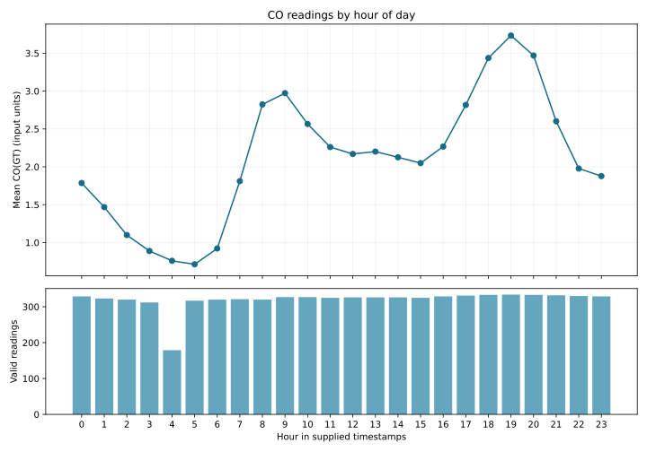

# Air Quality Patterns

A reproducible Python workflow for auditing air-quality measurements and exploring hourly and monthly carbon monoxide patterns.

## Features

- Reads semicolon-delimited CSV files with decimal commas.
- Handles the `-200` missing-reading marker and reports it separately from blank cells.
- Audits 13 measurement columns without discarding observations because another measurement is absent.
- Calculates CO means, medians and valid-reading counts by hour and calendar month.
- Produces a chart combining hourly averages and the number of readings behind them.
- Validates timestamps, duplicate timestamps, numeric fields and required columns.
- Includes a fictional demo, six unit tests and an independent results checker.

## Results

The analyzed data span **10 March 2004 to 4 April 2005**, with **9,357 timestamped observations** after excluding 114 empty rows.

| Metric | Result |
|---|---:|
| Valid CO readings | 7,674 |
| Missing CO readings | 1,683 (17.99%) |
| Mean CO reading | 2.1527 input units |
| Highest hourly mean | 19:00 — 3.7332 (334 readings) |
| Lowest hourly mean | 05:00 — 0.7129 (317 readings) |
| Missing NMHC readings | 90.23% |



Hourly means pool available readings across all dates. Missing readings can affect comparisons; the results describe this historical sample and do not establish causes or current air quality. The workflow does not impute values or remove extreme readings. `CO(GT)` is summarized separately from `PT08.S1(CO)` sensor responses. Units and timezone are retained as supplied, without conversion.

## Run

Requires Python 3.10 or later.

```bash
python -m pip install -r requirements.txt
python analyze.py examples/demo.csv --output demo-results
python -m unittest -v
```

The demo contains fictional readings. For a full input file:

```bash
python analyze.py data/AirQuality.csv --output results
python verify_results.py data/AirQuality.csv results
```

The source dataset is not bundled; aggregate results are included.

## Input

`Date` uses `DD/MM/YYYY`; `Time` uses `HH.MM.SS`. Required measurements are:

```text
CO(GT), PT08.S1(CO), NMHC(GT), C6H6(GT), PT08.S2(NMHC),
NOx(GT), PT08.S3(NOx), NO2(GT), PT08.S4(NO2), PT08.S5(O3),
T, RH, AH
```

Extra columns are ignored. Rows empty across all required fields are excluded. Every retained row requires a unique timestamp. Blank cells and `-200` are missing measurements. At least one valid CO reading is required. An hourly group with no valid readings has count zero and an empty mean, rather than a zero concentration.

## Outputs

| File | Contents |
|---|---|
| `results/missingness.csv` | Valid counts, missing markers, blanks and missing percentages |
| `results/hourly_co.csv` | Hourly counts, means and medians |
| `results/monthly_co.csv` | Calendar-month counts, means and medians |
| `results/summary.json` | Observation totals, date range and CO average |
| `results/hourly_co.svg` | Hourly CO pattern and valid-reading counts |
| `results/verification.txt` | Validation record |

Missing percentages use all retained timestamped observations as the denominator. CO means and medians use only valid CO readings within each group. The independent checker uses Python's standard-library CSV and statistics functions.
